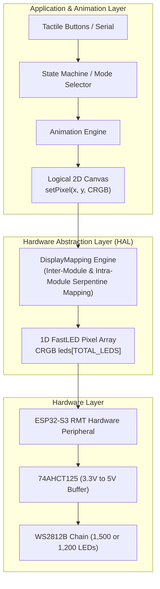
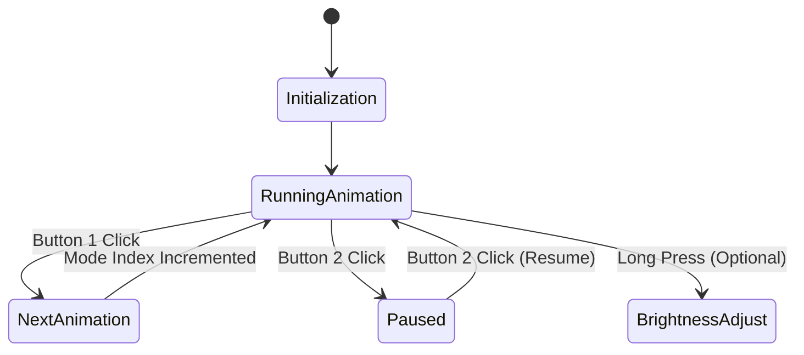

# System Architecture & Mapping Design

This document details the software architecture, coordinate mapping mathematics, and data flow of the **TinkerSpace Modular LED Display**.

---

## 1. High-Level System Architecture

The system decouples high-level animation rendering from physical LED hardware through an abstracted logical coordinate canvas:



---

## 2. Coordinate Mapping: From 2D (X, Y) to 1D Serial Index

A core design requirement is that software developers, students, and game designers should not need to know where individual wires are soldered. They draw to an intuitive Cartesian grid:
- **Origin `(0, 0)`**: **Bottom-Left corner** of the entire display.
- **X-axis**: Points right (`x = 0 .. DISPLAY_WIDTH - 1`, left to right).
- **Y-axis**: Points up (`y = 0 .. DISPLAY_HEIGHT - 1`, bottom to top).

### Physical Serpentine Raster Topology

```text
========================================================================
Left to right, bottom to top, row serpentine raster
========================================================================
Row 29 (Top):    [1499] <── [1498] <── ... <── [1451] <── [1450] (Right to Left)
                  │
Row 28:          [1400] ──> [1401] ──> ... ──> [1448] ──> [1449] (Left to Right)
                  ...
Row 2:           [100]  ──> [101]  ──> ... ──> [148]  ──> [149]  (Left to Right)
                  │
Row 1:           [99]   <── [98]   <── ... <── [51]   <── [50]   (Right to Left)
                  ▲
Row 0 (Bottom):  [0]    ──> [1]    ──> ... ──> [48]   ──> [49]   (Left to Right)
                (DIN)
```

### Physical Index Formula
Given global coordinates `(x, y)` where origin `(0, 0)` is at the bottom-left:
- If $y$ is **even** ($y = 0, 2, 4, \dots$): row runs Left $\to$ Right:
  $$\text{Index}(x, y) = (y \times \text{DISPLAY\_WIDTH}) + x$$
- If $y$ is **odd** ($y = 1, 3, 5, \dots$): row runs Right $\to$ Left:
  $$\text{Index}(x, y) = (y \times \text{DISPLAY\_WIDTH}) + (\text{DISPLAY\_WIDTH} - 1 - x)$$

### Four-Corner Physical Index Reference (50×30 Matrix)
- **Bottom-Left `(0, 0)`**: **Physical LED 0** (DIN from microcontroller)
- **Bottom-Right `(49, 0)`**: **Physical LED 49** (End of bottom row)
- **Top-Right `(49, 29)`**: **Physical LED 1450**
- **Top-Left `(0, 29)`**: **Physical LED 1499** (Final LED in chain)
3. Because rows alternate direction (serpentine cabling between modules):
   - If `module_y` is **even** (Rows 0, 2, ...): modules run left-to-right:
     $$\text{module\_index} = (\text{module\_y} \times \text{MODULES\_X}) + \text{module\_x}$$
   - If `module_y` is **odd** (Row 1, ...): modules run right-to-left:
     $$\text{module\_index} = (\text{module\_y} \times \text{MODULES\_X}) + (\text{MODULES\_X} - 1 - \text{module\_x})$$

### Stage 2: Intra-Module Serpentine (10×10 Internal Traces)
Standard 10×10 flexible FPCB WS2812B matrices are internally routed in serpentine rows:
- In odd rows within the module, the data traces travel backwards:
  - If `local_y` is **even**: $\text{pixel\_in\_module} = (\text{local\_y} \times 10) + \text{local\_x}$
  - If `local_y` is **odd**: $\text{pixel\_in\_module} = (\text{local\_y} \times 10) + (9 - \text{local\_x})$

### Final 1D Index Calculation
$$\text{Index} = (\text{module\_index} \times 100) + \text{pixel\_in\_module}$$

This transformation runs in sub-microsecond time on the ESP32-S3 and is implemented in `DisplayMapping::getPixelIndex(x, y)`.

---

## 4. Firmware Subsystems & State Machine



The firmware is structured into modular components:
1. **`config.h`**: Hardware pin assignments, grid dimensions, brightness caps, and layout presets.
2. **`display_mapping`**: Fast matrix translation routines with boundary clamping.
3. **`animations`**: Clean, non-blocking rendering classes for plasma, fire, waves, text scrolling, and color fills.
4. **`buttons`**: Non-blocking software debounce routine using state-edge detection.
5. **`led-display.ino`**: Top-level coordinator and timing scheduler.

---

## 5. Electrical Domain Isolation & Safety

The system features two interconnected electrical domains:
1. **Low-Voltage Signal Domain (3.3 V)**: The ESP32-S3 microcontroller operates at 3.3 V CMOS levels. The RMT output is passed to a high-speed CMOS buffer (74AHCT125) powered by 5.0 V.
2. **High-Current Power Domain (5.0 V)**: A 500 W industrial switching power supply drives the LED matrix through heavy-gauge copper busbars and individually fused branch lines.

A single, unified ground plane connects the power supply, LED strips, logic level shifter, and ESP32-S3 ground pins to prevent floating signal references and noise glitches.
